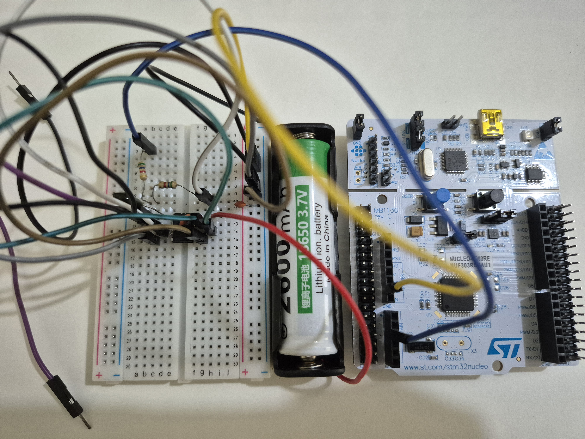
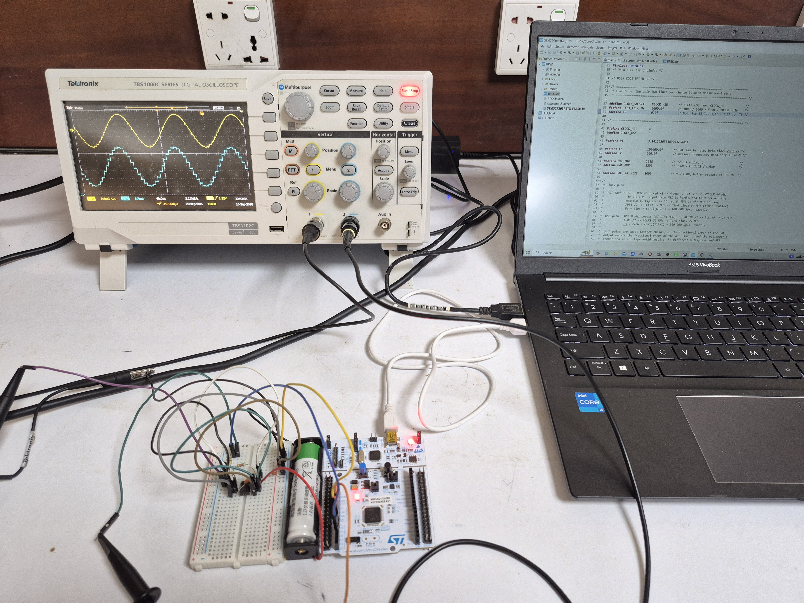

# STM32 Baseband Phase Modulation: Measurement and Analysis Repository

Firmware, raw oscilloscope data, Python analysis scripts and result plots for the BSc thesis

> **Implementation and Performance Analysis of a Baseband Phase Modulation System with STM32 for Low-Power Wireless Communication**
>
> Mohammad Moyeenur Rahman (Roll 2001144) and A S M Redoun Alam (Roll 2001174)<br>
> Supervisor: Prof. Dr. Md. Masud Rana<br>
> Department of Electrical & Electronic Engineering, Rajshahi University of Engineering & Technology (RUET), Bangladesh, August 2026
>
> 📄 **Full thesis:** [`Thesis_book.pdf`](Thesis_book.pdf)

The repository provides the available raw experimental measurements, STM32 firmware, Python analysis scripts, result plots, and documented calculation procedures supporting the thesis. Most oscilloscope-based analyses can be reproduced from the provided CSV files without the original hardware. Each measurement folder has its own step-by-step guide, so the results can be **reproduced without any hardware**.

---

## 1. The thesis in short

**The question.** Phase modulation (PM) and phase-shift keying are basic to many radio systems, but studying them in practice usually needs expensive RF or SDR hardware. Can a cheap, general-purpose microcontroller generate phase-modulated signals with its own on-chip DAC, at low power, and with performance that is measured and understood?

**The system.** An STM32 Nucleo-F303RE computes one buffer of waveform samples in firmware. TIM6 triggers the 12-bit DAC at 100 kSa/s, and circular DMA replays the buffer forever, so the CPU can sleep while the signal runs. A second-order Sallen-Key low-pass filter removes the DAC staircase.

```
 STM32F303RE                                                     Test Point A       Test Point B
┌───────────────────────────────────────────────┐                     │                  │
│ waveform buffer ──► DMA (circular) ──► DAC1 ──┼── PA4 ──────────────┴──► Sallen-Key ───┴──► output
│   (PM / BPSK / QPSK,        ▲                 │                         LPF, 20.1 kHz
│    computed once at start)  │ TIM6 TRGO       │                         (MCP6002)
│                             │ 100 kSa/s       │
└───────────────────────────────────────────────┘
```

Changing the modulation (pure carrier, analog PM, BPSK, QPSK) is a **firmware change only**. This is what makes the platform software-defined.

| Parameter | Value |
|---|---|
| Microcontroller | STM32F303RE (Nucleo-64 board), 12-bit DAC1 on PA4 |
| DAC update rate | 100 kSa/s (TIM6 TRGO → circular DMA) |
| Carrier / message frequency | 5 kHz / 500 Hz |
| BPSK symbol rate | 500 bit/s |
| Buffer | 1000 samples (10 ms), an exact number of carrier, message and symbol periods |
| DAC amplitude | 2048 ± 1200 codes |
| Reconstruction filter | Unity-gain Sallen-Key Butterworth, R = 5.6 kΩ, C1 = 2.2 nF, C2 = 1 nF, f_c ≈ 20.1 kHz, MCP6002 at 4.05 V |
| Main instrument | Tektronix TBS1102C (8-bit, 2000-point records) |
| Analysis | Python 3 (NumPy, SciPy, Matplotlib): FFT, Hilbert transform, sine fitting, statistics |

**What was measured.** Six performance metrics: **power consumption, output-frequency accuracy, phase deviation and accuracy, spectrum, SNR/SINAD/ENOB/SFDR, and THD**. The system was then extended toward **software-defined radio (SDR)**: QPSK generation, an offline Python receiver for BPSK and QPSK, a noise (EVM-vs-SNR) test, and a BPSK bit-error-rate simulation.

<p align="center">
  
  &nbsp;
  
</p>
<p align="center"><sub>Left: Nucleo-F303RE and the breadboard reconstruction filter (op-amp powered from a separate 18650 cell). Right: bench setup with the TBS1102C oscilloscope.</sub></p>

---

## 2. Key results

Values as reported in the thesis (Table 5.37 and Chapter 6). "Bound" means the oscilloscope limits the measurement, so the true value is at least this good.

| Area | Result | Type |
|---|---|---|
| **Power** | MCU power in the implemented PM mode (72 MHz, CPU sleeping): **43.6 ± 2.4 mW** | Measured |
| | Extra power needed for PM generation: **6.6 ± 1.8 mW**, about **13.2 ± 3.6 µJ/bit** at 500 bit/s | Measured / derived |
| | Lowest tested MCU power: **11.5 mW** at 8 MHz. Reconstruction filter: **1.17 mW** | Measured |
| **Frequency accuracy** | Internal HSI oscillator error: **+3126 ppm** (+3125.51 ± 63.99 ppm, ratiometric) | Measured |
| | HSE crystal error: **< 110 ppm** | Bound (scope timebase ±20 ppm) |
| | The DAC, DMA, timer, modulation and filter add no measurable frequency error; the output error equals the clock error | Measured |
| **Phase** | Phase-sensitivity slope **0.9946** over 0.25–4 rad (−0.54 % full range; −0.03 % at 1 rad), R² = 0.99999 | Measured |
| | First Bessel null (carrier disappears) found **+0.103 %** from theory: a calibration-free check of the phase law | Measured |
| | BPSK phase reversal **−179.94° ± 0.16°** | Measured |
| **Spectrum** | Carrier suppression at the Bessel null (kp = 2.4048): **54.9 dB** | Measured |
| | PM deviation recovered from the sideband pattern within **0.12 %**; occupied bandwidth within **+1.6 / −9.1 / +4.1 %** of Carson's rule | Measured |
| | Filtered DAC images: **−42.28 dBc** (95 kHz) and **−43.48 dBc** (105 kHz) | Measured |
| **Noise** | Filtered output: in-band SNR **38.62 dB** (robust 41.09 dB), SINAD **32.32 dB**, ENOB **5.85 bits**, SFDR **42.21 dB** | Measured (interference-limited) |
| | The filter improves SINAD by 11.63 dB and ENOB by 1.93 bits | Measured |
| **Distortion** | THD at the 1200-code operating point: **≤ −46.45 dBc** (1 kHz) | Bound |
| | At 1500 codes the op-amp flattens the peaks: **−37.53 dBc** (1.33 %) | Measured |
| **SDR extension** | EVM: QPSK (NRZ) **1.636 %**, BPSK **1.972 %**, QPSK (raised-cosine) **≤ 0.6 %**. 0 bit errors in all captured symbols | Measured / bound |
| | The receiver's carrier estimate (+2992 ppm) matches the independently measured HSI error | Cross-check |
| | BPSK BER simulation matches theory within Monte Carlo uncertainty over seven decades of BER | Software validation |

**Main limits** (stated in the thesis): the 8-bit oscilloscope (about 44.8 dB noise limit, ±20 ppm timebase), interference on the development board, high-frequency feedthrough in the active filter, and the fact that the system is wired and baseband only, with no RF or over-the-air link. The zero decision errors in the SDR tests do **not** represent a hardware bit error rate.

---

## 3. Repository structure

Each measurement folder has the same layout and its own guide.

| Folder | Thesis section | Guide | What it contains |
|---|---|---|---|
| [`power_consumption/`](power_consumption) | 4.3, 5.3 | [Power measurement procedure](power_consumption/power_measurement_procedure.md) | Firmware for the power modes, plot scripts and plots (no CSV: readings were taken with a multimeter) |
| [`frequency_accuracy/`](frequency_accuracy) | 4.4, 5.4 | [Frequency accuracy procedure](frequency_accuracy/Frequency_Accuracy_procedure.md) | HSI vs HSE captures at 1–10 kHz, MCO, PM, filter and warm-up tests |
| [`phase_accuracy/`](phase_accuracy) | 4.5, 5.5 | [Phase accuracy procedure](phase_accuracy/phase_accuracy_procedure.md) | kp sweep (Hilbert transform), Bessel-null search, BPSK phase reversal, reference captures |
| [`spectrum/`](spectrum) | 4.6, 5.6 | [Spectral analysis procedure](spectrum/spectral_analysis_procedure.md) | DAC images before/after the filter, Bessel sidebands, occupied bandwidth, BPSK spectra |
| [`SNR/`](SNR) | 4.7, 5.7 | [SNR measurement procedure](SNR/SNR_measurement_procedure.md) | In-band and wideband SNR (spectrum method), SINAD and ENOB (IEEE 1241 sine fit), SFDR |
| [`THD/`](THD) | 4.8, 5.8 | [THD measurement procedure](THD/THD_measurement_procedure.md) | THD at 1 and 5 kHz, amplitude sweep, Point A vs B, instrument floor check |
| [`SDR/`](SDR) | Chapter 6 | [SDR analysis procedure](SDR/SDR_analysis_procedure.md) | QPSK firmware, BPSK/QPSK software receiver, EVM-vs-SNR sweep, BER simulation |
| [`hardware_setup/`](hardware_setup) | Chapter 3 | — | Photos of the circuit and the bench |
| [`Thesis_book.pdf`](Thesis_book.pdf) | — | — | The complete thesis |

Inside each measurement folder:

```
<metric>/
├── csv/                    raw oscilloscope exports, one sub-folder per test case
├── firmware/               STM32 main.c used for that test (CubeMX project, STM32CubeIDE)
├── python/                 analysis scripts
├── result_plots/           plots made by the scripts
├── oscilloscope_images/    screenshots taken on the oscilloscope
└── <metric>_procedure.md   how the test was done and how to reproduce it
```

The guides explain, for every test case: which firmware build was flashed, the oscilloscope settings, which CSV files belong to it, which command turns them into a result, the expected printed output, and what each plot shows.

---

## 4. More plots and screenshots than in the thesis

The thesis book has room for only a selection of figures (about 20 result figures in Chapters 5 and 6). **This repository keeps everything else.** Many result plots and oscilloscope screenshots were left out of the final thesis book but are available here, for example:

- spectra of every individual test case (each PM deviation, both BPSK versions, the noise floors);
- the oscilloscope's own FFT screenshots and the time-domain screen captures of each case;
- residual spectra and sine-fit plots behind the SINAD/ENOB numbers;
- histograms, residuals, envelope-ripple and noise plots from the phase tests;
- the uncertainty budget and per-measurement-point error plots for frequency accuracy;
- the instrument-floor and op-amp clipping plots for THD;
- for the SDR work: waveforms, I/Q tracks, eye diagrams and spectra of every QPSK and BPSK run, and the scope screenshots of the QPSK signals.

| Folder | Result plots | Oscilloscope images |
|---|---|---|
| power_consumption | 4 | — |
| frequency_accuracy | 6 | 6 |
| phase_accuracy | 15 | 4 |
| spectrum | 14 | 10 |
| SNR | 20 | 7 |
| THD | 8 | 5 |
| SDR | 24 | 2 |
| **Total** | **91** | **34** |

Each folder's guide lists every plot and screenshot with a short description of what it shows.

---

## 5. Reproducing the results

No hardware is needed. Every analysis runs from the CSV files in this repository.

```bash
git clone https://github.com/moyeenurrahman/STM32_phase_modulation_research
cd STM32_phase_modulation_research
pip install numpy scipy matplotlib
```

Then open the guide of the folder you want and follow its reproduction section:

| Folder | Reproduction section in the guide |
|---|---|
| power_consumption | Section 4, *Quick reproduction of the plots* |
| frequency_accuracy, phase_accuracy, spectrum, SDR | Section 10, *Quick start (no hardware)* |
| SNR, THD | Section 3, *Quick reproduction (no hardware)* |

Each folder runs in a few minutes or less. The SDR folder, for example:

```bash
cd SDR
mkdir reproduced_plots
python python/qpsk_analysis.py --csv csv/QPSK_NRZ/qpsk_mode0_nrz_2p5msdiv_cap1.csv csv/QPSK_NRZ/qpsk_mode0_nrz_2p5msdiv_cap2.csv csv/QPSK_NRZ/qpsk_mode0_nrz_2p5msdiv_cap3.csv --mode passband --shape nrz --prefix reproduced_plots/qpsk_nrz
# prints: EVM (RMS) : 1.636 %
```

To regenerate the signals on hardware, you need a Nucleo-F303RE, STM32CubeIDE, the filter described above, and an oscilloscope. Each `firmware/` file is a `main.c` with the test selected by changing one `#define` (see the guide).

**Software used:** STM32CubeIDE 1.18.1 (HAL), Python 3 with NumPy, SciPy and Matplotlib.

---

## 6. Notes on names and numbering

- **Test names.** Some tests were renamed late in the work. The CSV files and scripts keep the original names: frequency tests **T1–T7 = F1–F7**, phase tests **M1–M3 = PH1–PH3**, power modes **M0–M3 = P0–P3**. The guides of those three folders give the mapping.
- **Chapter and figure numbers.** The folder guides were written alongside an earlier draft of the thesis. Where a guide cites a chapter, figure or table number, it may differ from the final book. In the final [`Thesis_book.pdf`](Thesis_book.pdf), the methodology is Chapter 4, the results are Chapter 5, and the SDR extension is Chapter 6.
- **Shared data.** Some captures serve two analyses and appear in two folders (for example, the wide-span spectrum cases are the SNR captures, and the SDR BPSK captures are spectral case S6N). The guides state this and confirm the files are identical.

---

## 7. Citation

If you use this data or code, please cite the thesis:

```
M. M. Rahman and A. S. M. R. Alam, "Implementation and Performance Analysis of a Baseband
Phase Modulation System with STM32 for Low-Power Wireless Communication," B.Sc. thesis,
Dept. of Electrical & Electronic Engineering, Rajshahi University of Engineering & Technology
(RUET), Rajshahi, Bangladesh, Aug. 2026.
```
